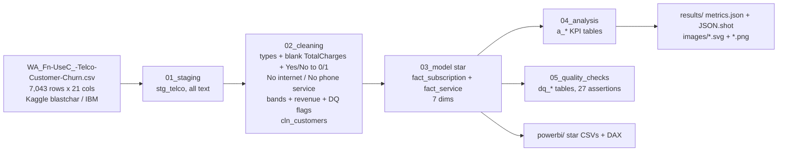

# da-learn-12 · Telecom customer churn (IBM Telco sample)

A data-analyst learning project. It analyses the **Telco Customer Churn dataset (IBM sample data, Kaggle: 7,043 customers of a fictional telco, 21 columns, one snapshot)**. The goal is to find out who churns, when they churn, and how much monthly revenue leaves with them. The raw CSV goes through SQL staging, then cleaning: blank `TotalCharges`, `SeniorCitizen` 0/1 vs Yes/No, the "No internet service" and "No phone service" categories, boolean standardisation, tenure and charge bands, and an integrity flag comparing TotalCharges with MonthlyCharges × tenure. After that come a star schema, KPI and business-question tables, and quality checks. DuckDB runs the whole pipeline locally on the **full** file. The outputs are a Power BI kit plus SVG and PNG charts in `results/images/`.

> **Databricks was skipped** for this project because the Databricks workspace hit its resource quota. There is no live Lakeview dashboard. The SQL stays Databricks/Spark-compatible (the DuckDB shims are isolated in `sql/00`), and all charts and KPIs are in [`results/`](results/RESULTS.md).


## Business questions
1. What is the overall churn rate, and how much monthly recurring revenue (MRR) is at risk from customers who left?
2. How does churn differ by contract type, and how much of the lost revenue sits in month-to-month contracts?
3. When do customers churn? How does churn change with tenure, and does tenure still matter once the contract is fixed (tenure-year cohorts × contract)?
4. Which payment methods and billing setups churn most?
5. How do internet service type and the six add-on services (security, backup, device protection, tech support, streaming TV and movies) relate to churn?
6. Do senior citizens, customers with partners and customers with dependents behave differently? Does gender matter?
7. Which combined segments (contract × internet × payment) carry the highest churn and the most lost revenue?
8. How do churned and retained customers compare on monthly charges, tenure and lifetime revenue to date (a CLV proxy)?
9. How clean is the raw file (blank values, inconsistent flags, charge integrity, duplicates)?

## Pipeline


## Headline insights (full data)
- **Overall churn and revenue at risk:** **1,869 of 7,043 customers churned (26.54%)**. They took **$139,130.85 of $456,116.60 MRR (30.50%)**, or **$1.67M a year**. Churners paid more per month than retained customers ($74.44 vs $61.27) but left early (median tenure **10 vs 38 months**), so their lifetime revenue to date averages $1,531.80 against $2,549.91.
- **Contract is the strongest lever:** month-to-month customers churn at **42.71%**, against 11.27% on one-year and **2.83% on two-year** contracts (15× lower). Month-to-month is 55% of the base but **88.55% of churners and 86.86% of the MRR lost**.
- **Churn is front-loaded:** 52.94% of customers in their first six months churned (61.99% in month 1, 380 of 613), against 6.61% after five years, and 55.48% of all churners were in their first year. Inside month-to-month contracts, churn still falls from 51.35% (year 1) to 22.22% (year 6), so tenure matters beyond the contract mix.
- **Fiber and electronic check are red flags:** fiber-optic customers churn at **41.89%** (DSL 18.96%, no internet 7.40%) while paying $91.50/month on average, and they account for 82.15% of the MRR lost. Electronic check churns at **45.29%**, against 15-17% for automatic bank or card payment. The segment **month-to-month + fiber + electronic check** (1,307 customers) churns at **60.37%** and alone holds **49.08% of all lost MRR** ($68,281.50/month).
- **Protection add-ons go with loyalty, streaming does not:** among internet customers, online security (14.61% vs 41.77%) and tech support (15.17% vs 41.64%) cut churn by about 27 points; streaming TV and movies by only 3-4 points. Churn falls from 52.24% with no add-ons to 5.28% with all six, although add-on count and tenure rise together.
- **Demographics:** senior citizens churn at 41.68% vs 23.61%; customers with a partner (19.66% vs 32.96%) or dependents (15.45% vs 31.28%) churn less; gender makes no difference (26.92% female vs 26.16% male).
- **Data quality:** 27 / 27 assertions pass, and no row is dropped (7,043 → 7,043, no duplicate ids). The 11 blank `TotalCharges` all belong to tenure-0 customers and are set to 0.00. `SeniorCitizen` 0/1 and every Yes/No column become 0/1 flags, and the "No internet service" (1,526 customers) and "No phone service" (682) categories are mapped to 0. 27 customers whose TotalCharges is more than 25% away from MonthlyCharges × tenure are flagged and kept; all of them are in their first 9 months. 42 customers share an identical 19-attribute profile with another id, which is a trace of the synthetic data (kept).

## Charts
All charts are in `results/images/` as SVG (plain vector shapes) and PNG (2x render of the same SVG). Red bars = above the 26.5% average churn rate.

| | |
|---|---|
|  |  |
|  |  |
|  |  |
|  |  |
|  |  |
|  | |

## How to run
```bash
pip install -r requirements.txt
python run_pipeline.py --source sample       # committed 1,477-customer sample in data/raw/, results in results/sample/
python scripts/download_full_data.py         # 977,501 B into data/raw_full/ (SHA-256 checked, 6 public mirrors)
python run_pipeline.py --source full         # full file: results/, data/clean/, powerbi/data/
python scripts/render_png.py                 # results/images/*.svg -> *.png with headless Chrome
```
`scripts/make_sample.py` rebuilds the committed sample from the full file. The runner stops with an error if any assertion fails.

## Repo layout
```
data/raw/            1,477-customer raw sample (byte-for-byte lines; every cleaning rule exercised); full file via scripts/download_full_data.py
data/clean/          customers.csv (7,043 cleaned customers, typed + banded + flagged), full size
sql/                 00 DuckDB shims, 01 staging, 02 cleaning, 03 star model, 04 analysis, 05 quality checks
run_pipeline.py      DuckDB runner (sample | full)
scripts/             project config, sample builder, downloader, SVG chart writer, PNG renderer
results/             RESULTS.md, metrics.json, JSON.shot, tables/*.csv, images/*.svg + *.png (dashboard = overview)
powerbi/             full star CSVs (~2.2 MB), measures.dax, model.md, dashboard_spec.md, BUILD_GUIDE.md
```

## Caveats
- **Fictional, single-snapshot data.** This is IBM sample data for a made-up telco. Every customer appears once, with the current contract and charges. There are no dates, so "tenure cohorts" compare customers by how long they have stayed (a cross-section), not true join-date cohorts or survival curves.
- **Churn = left within the last month.** Churned customers are those who just left, so the churn rate is a one-month snapshot of the base, not an annual rate.
- **Revenue at risk** is the MonthlyCharges of churned customers (×12 for a year). It ignores win-backs and has no cost or margin data. Lifetime revenue is TotalCharges to date, not a forward-looking CLV.
- **Single-factor comparisons, not causal effects.** Contract, tenure, fiber, electronic check and add-ons overlap heavily. For example, customers with more add-ons have also stayed longer. The driver chart ranks factors one at a time and does not estimate a model.
- **Blank TotalCharges → 0.00** is a business assumption: those customers have tenure 0 and have not been billed yet. The raw blank is kept as `dq_total_charges_blank`.
- Medians are exact on DuckDB (`quantile_cont`); Spark's `percentile_approx` can differ slightly.
- IBM later published a richer "Telco customer churn 11.1.3" version (location, churn reason, satisfaction, CLTV), linked from the Kaggle page. This project uses the classic Kaggle 21-column file.

## Complete dataset
- **Kaggle page:** https://www.kaggle.com/datasets/blastchar/telco-customer-churn ("Telco Customer Churn", uploaded by BlastChar; origin: IBM Sample Data Sets, "Predict behavior to retain customers"). 7,043 customers of a fictional telco.
- **Mirrors used (exact URLs).** These three are byte-identical to the Kaggle file (977,501 B, CRLF line endings), SHA-256 `88be4b93fbe0cc83421af1c503794c97c342eca914c1576db7c276e61d61358a`:
  - https://raw.githubusercontent.com/carlosfab/dsnp2/master/datasets/WA_Fn-UseC_-Telco-Customer-Churn.csv (primary)
  - https://raw.githubusercontent.com/dsrscientist/DSData/master/Telecom_customer_churn.csv
  - https://raw.githubusercontent.com/srees1988/predict-churn-py/main/customer_churn_data.csv
- **Same content with LF line endings** (970,457 B, SHA-256 `16320c9c1ec72448db59aa0a26a0b95401046bef5d02fd3aeb906448e3055e91`). Converting LF to CRLF reproduces the Kaggle SHA-256 exactly, and the downloader does this automatically:
  - https://raw.githubusercontent.com/IBM/telco-customer-churn-on-icp4d/master/data/Telco-Customer-Churn.csv (IBM's own repository)
  - https://raw.githubusercontent.com/treselle-systems/customer_churn_analysis/master/WA_Fn-UseC_-Telco-Customer-Churn.csv
  - https://huggingface.co/datasets/scikit-learn/churn-prediction/resolve/main/dataset.csv
- **Licence:** Kaggle lists it as **"Data files © Original Authors"** (IBM sample data; no explicit open-data licence is stated on Kaggle). IBM's GitHub copy sits in an Apache-2.0 repository, and the Hugging Face copy is tagged CC BY 4.0 by its uploader. The terms are not fully clear, so treat the data as IBM sample data for learning and analysis, and credit IBM and Kaggle/BlastChar. This repo commits only a 1,477-row sample plus derived tables.
- **Total size:** 977,501 bytes (~0.98 MB), a single file.
- **Files:** `WA_Fn-UseC_-Telco-Customer-Churn.csv`: 7,043 rows × 21 columns (`customerID, gender, SeniorCitizen, Partner, Dependents, tenure, PhoneService, MultipleLines, InternetService, OnlineSecurity, OnlineBackup, DeviceProtection, TechSupport, StreamingTV, StreamingMovies, Contract, PaperlessBilling, PaymentMethod, MonthlyCharges, TotalCharges, Churn`).
- **Download:** `python scripts/download_full_data.py` (tries the six mirrors in order, verifies SHA-256, writes `data/raw_full/WA_Fn-UseC_-Telco-Customer-Churn.csv`)
