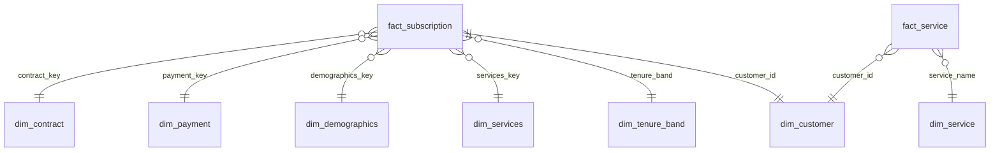

# Power BI model - da-learn-12 Telecom customer churn

Import every CSV in `powerbi/data/` (full data: 7,043 customers; built by `python run_pipeline.py --source full`). The star CSVs total ~2.2 MB (fact_service 0.8 MB, dim_customer 0.8 MB, fact_subscription 0.7 MB).

| Table | Grain | Key | Notes |
|---|---|---|---|
| fact_subscription | one customer (current subscription snapshot) | customer_id | tenure_months, monthly_charges, total_charges, expected_total_charges (monthly × tenure), avg_billed_per_month, charge_band, addon_count, churned (0/1), mrr_lost, mrr_retained, annualised_revenue_lost, outlier and DQ flags; 7,043 rows |
| fact_service | customer × subscribed service line | customer_id + service_name | only services the customer has (Phone, Multiple lines, Internet: DSL / Fiber optic, 6 add-ons) + churned; 29,202 rows |
| dim_customer | customer | customer_id | readable labels (gender, senior_citizen, partner, dependents, contract, payment, internet, tenure band, churn_label) for drill-through |
| dim_contract | contract type | contract_key | Month-to-month (1), One year (12), Two year (24), is_term_contract |
| dim_payment | payment method | payment_key | 4 methods, is_auto_pay, payment_channel (Check / Bank / Card) |
| dim_demographics | gender × senior × partner × dependents | demographics_key | 16 combinations + household label |
| dim_services | service bundle (junk dimension) | services_key | 322 distinct bundles: phone, multiple lines, internet type, 6 add-on flags, add-on counts, service_profile |
| dim_tenure_band | tenure band | tenure_band | 7 bands (`a 0-6 m` … `g 61-72 m`) with min / max months |
| dim_service | service line | service_name | 10 services with service_group and subscriber count |

## Relationships
- `fact_subscription[contract_key]` → `dim_contract[contract_key]`, `[payment_key]` → `dim_payment`, `[demographics_key]` → `dim_demographics`, `[services_key]` → `dim_services`, `[tenure_band]` → `dim_tenure_band` (all many-to-one, single direction)
- `fact_subscription[customer_id]` → `dim_customer[customer_id]` (one-to-one; set cross-filter to single, dim_customer filters the fact)
- `fact_service[customer_id]` → `dim_customer[customer_id]` and `fact_service[service_name]` → `dim_service[service_name]` (many-to-one)
- Sort `tenure_band` and `charge_band` by themselves (they carry a letter prefix). Load `customer_id` as Text.
