# Results - da-learn-12 Telecom customer churn (IBM Telco sample)

Run: `python run_pipeline.py --source full` on DuckDB (local, full file: 7,043 raw customers → 7,043 clean customers, 0 rows dropped). Databricks was skipped because the workspace hit its resource quota, so there is no live dashboard; every number below is in `metrics.json` and `tables/`. **Churn = the customer left within the last month (`Churn = Yes`); churn rate = churned / customers. MRR = sum of current `MonthlyCharges`; revenue at risk (MRR lost) = `MonthlyCharges` of churned customers (×12 = annualised). Lifetime revenue = `TotalCharges` billed to date.** The file is one snapshot, so tenure "cohorts" compare customers by how long they have stayed.

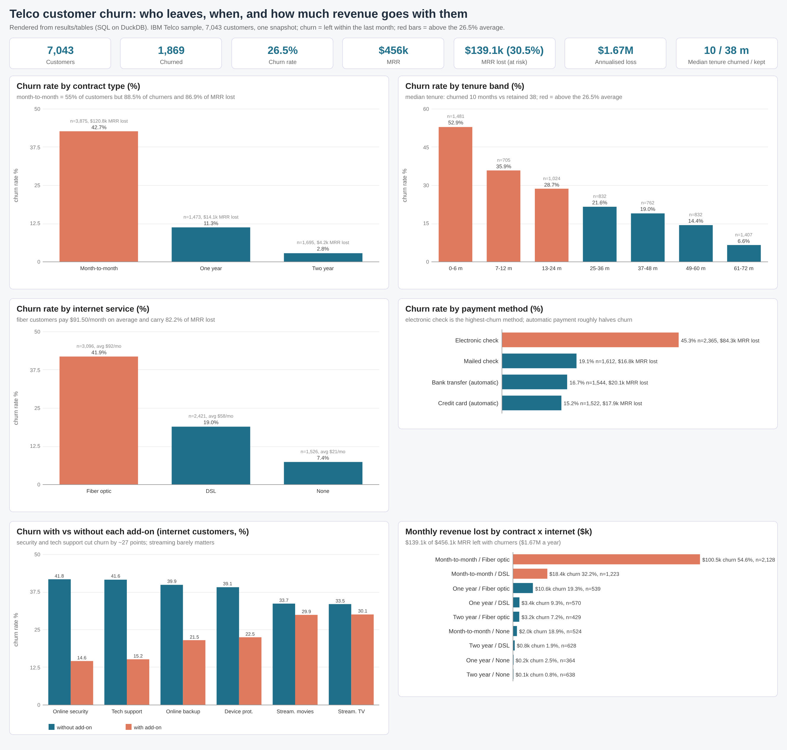

## Headline KPIs
| KPI | Value |
|---|---|
| Customers / churned / retained | 7,043 / 1,869 / 5,174 |
| Churn rate | 26.54% |
| MRR (all customers) | $456,116.60 |
| MRR lost to churners (revenue at risk) | $139,130.85 (30.50% of MRR) |
| Annualised revenue lost (×12) | $1,669,570.20 |
| Avg monthly charge: all / churned / retained | $64.76 / $74.44 / $61.27 |
| Median tenure: churned / retained | 10 / 38 months |
| Lifetime revenue to date: total / churned customers | $16,056,168.70 / $2,862,926.90 |
| Avg lifetime revenue: churned / retained | $1,531.80 / $2,549.91 |
| Month-to-month share of customers / of churners | 55.02% / 88.55% |
| Churners in their first 12 months | 55.48% |
| Fiber share / senior share | 43.96% / 16.21% |
| New customers (tenure 0, not yet billed) | 11 |
| TotalCharges off MonthlyCharges × tenure by > 25% (flagged) | 27 |

## Churned vs retained
| status | customers | mrr | mrr_share_pct | avg_monthly_charges | median_monthly_charges | avg_tenure_months | median_tenure_months | lifetime_revenue | avg_lifetime_revenue | median_lifetime_revenue | avg_addons | annualised_mrr |
|---|---|---|---|---|---|---|---|---|---|---|---|---|
| Churned | 1,869 | 139,130.85 | 30.5 | 74.44 | 79.65 | 18.0 | 10.0 | 2,862,926.9 | 1,531.8 | 703.55 | 1.77 | 1,669,570.2 |
| Retained | 5,174 | 316,985.75 | 69.5 | 61.27 | 64.42 | 37.6 | 38.0 | 13,193,241.8 | 2,549.91 | 1,679.52 | 2.14 | 3,803,829 |

Churned customers pay more per month ($74.44 vs $61.27 on average) but leave early (median 10 vs 38 months), so their lifetime revenue to date is lower ($1,531.80 vs $2,549.91). They hold 30.5% of MRR while being 26.5% of customers.

## Contract
| contract | customers | churned | churn_rate_pct | churner_share_pct | mrr_lost | mrr_lost_share_pct | avg_monthly_charges | avg_tenure_months |
|---|---|---|---|---|---|---|---|---|
| Month-to-month | 3,875 | 1,655 | 42.71 | 88.55 | 120,847.1 | 86.86 | 66.4 | 18.0 |
| One year | 1,473 | 166 | 11.27 | 8.88 | 14,118.45 | 10.15 | 65.05 | 42.0 |
| Two year | 1,695 | 48 | 2.83 | 2.57 | 4,165.3 | 2.99 | 60.77 | 56.7 |

Month-to-month customers churn at 42.71%, 15× the two-year rate (2.83%). They are 55% of customers but 88.55% of churners and 86.86% of the MRR lost.

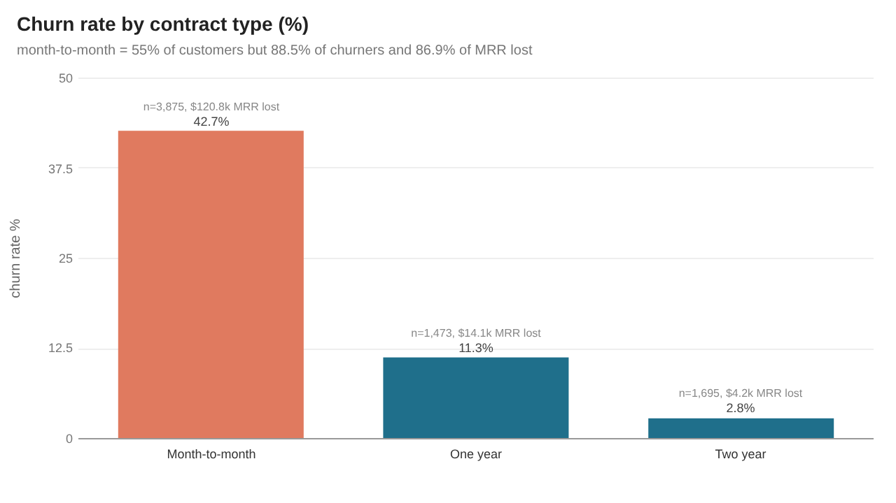

## Tenure
| tenure_band | customers | churned | churn_rate_pct | churner_share_pct | mrr_lost | mrr_lost_share_pct | avg_monthly_charges | avg_tenure_months |
|---|---|---|---|---|---|---|---|---|
| a 0-6 m | 1,481 | 784 | 52.94 | 41.95 | 49,896.1 | 35.86 | 54.74 | 2.5 |
| b 7-12 m | 705 | 253 | 35.89 | 13.54 | 19,058.15 | 13.7 | 58.95 | 9.4 |
| c 13-24 m | 1,024 | 294 | 28.71 | 15.73 | 23,081.65 | 16.59 | 61.36 | 18.4 |
| d 25-36 m | 832 | 180 | 21.63 | 9.63 | 15,167.95 | 10.9 | 65.58 | 30.3 |
| e 37-48 m | 762 | 145 | 19.03 | 7.76 | 12,294.55 | 8.84 | 66.32 | 42.6 |
| f 49-60 m | 832 | 120 | 14.42 | 6.42 | 10,581.9 | 7.61 | 70.55 | 54.5 |
| g 61-72 m | 1,407 | 93 | 6.61 | 4.98 | 9,050.55 | 6.51 | 75.95 | 68.1 |

More than half of customers in their first six months churned (52.94%), against 6.61% after five years. Month 1 alone: 380 of 613 customers (61.99%) churned.

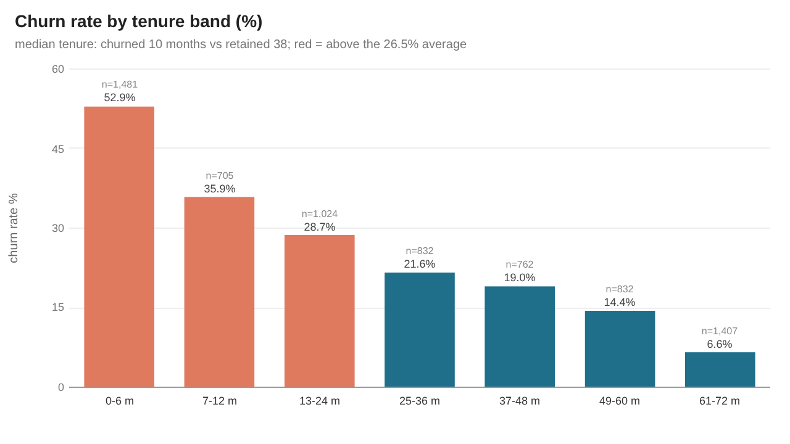
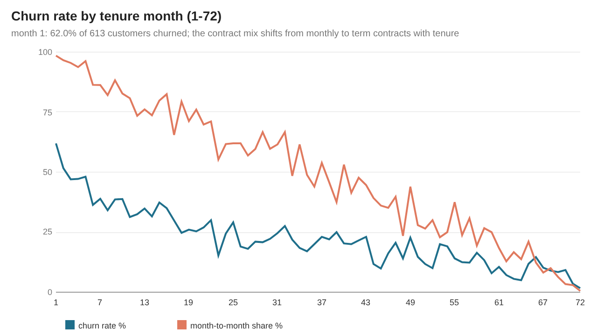

Tenure-year cohorts split by contract (does tenure still matter once the contract is fixed?):

| tenure_year | contract | customers | churned | churn_rate_pct | avg_monthly_charges | mrr_lost |
|---|---|---|---|---|---|---|
| Y1 0-12 | Month-to-month | 1,994 | 1,024 | 51.35 | 58.22 | 68,301.45 |
| Y1 0-12 | One year | 124 | 13 | 10.48 | 35.8 | 652.8 |
| Y1 0-12 | Two year | 68 | 0 | 0.0 | 30.95 | 0.0 |
| Y2 13-24 | Month-to-month | 737 | 278 | 37.72 | 69.31 | 21,980.3 |
| Y2 13-24 | One year | 197 | 16 | 8.12 | 44.88 | 1,101.35 |
| Y2 13-24 | Two year | 90 | 0 | 0.0 | 32.31 | 0.0 |
| Y3 25-36 | Month-to-month | 486 | 158 | 32.51 | 74.33 | 13,416.95 |
| Y3 25-36 | One year | 250 | 20 | 8.0 | 58.1 | 1,701.75 |
| Y3 25-36 | Two year | 96 | 2 | 2.08 | 40.75 | 49.25 |
| Y4 37-48 | Month-to-month | 316 | 106 | 33.54 | 78.42 | 9,140.05 |
| Y4 37-48 | One year | 268 | 35 | 13.06 | 65.55 | 2,819.6 |
| Y4 37-48 | Two year | 178 | 4 | 2.25 | 45.98 | 334.9 |
| Y5 49-60 | Month-to-month | 234 | 65 | 27.78 | 82.68 | 5,684.45 |
| Y5 49-60 | One year | 321 | 44 | 13.71 | 75.13 | 4,034.4 |
| Y5 49-60 | Two year | 277 | 11 | 3.97 | 55.0 | 863.05 |
| Y6 61-72 | Month-to-month | 108 | 24 | 22.22 | 91.44 | 2,323.9 |
| Y6 61-72 | One year | 313 | 38 | 12.14 | 84.11 | 3,808.55 |
| Y6 61-72 | Two year | 986 | 31 | 3.14 | 71.67 | 2,918.1 |

Inside month-to-month, churn falls from 51.35% in year 1 to 22.22% in year 6; one- and two-year contracts stay low at every tenure (0-14%). Part of the overall tenure effect is the contract mix: 91% of year-1 customers are on monthly contracts, against 8% in year 6.

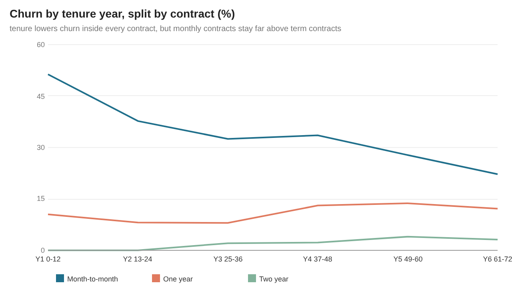

## Payment, billing and charges
| payment_method | is_auto_pay | customers | churned | churn_rate_pct | churner_share_pct | mrr_lost | mrr_lost_share_pct | avg_monthly_charges | avg_tenure_months |
|---|---|---|---|---|---|---|---|---|---|
| Electronic check | 0 | 2,365 | 1,071 | 45.29 | 57.3 | 84,288.75 | 60.58 | 76.26 | 25.2 |
| Mailed check | 0 | 1,612 | 308 | 19.11 | 16.48 | 16,803.6 | 12.08 | 43.92 | 21.8 |
| Bank transfer (automatic) | 1 | 1,544 | 258 | 16.71 | 13.8 | 20,091.9 | 14.44 | 67.19 | 43.7 |
| Credit card (automatic) | 1 | 1,522 | 232 | 15.24 | 12.41 | 17,946.6 | 12.9 | 66.51 | 43.3 |

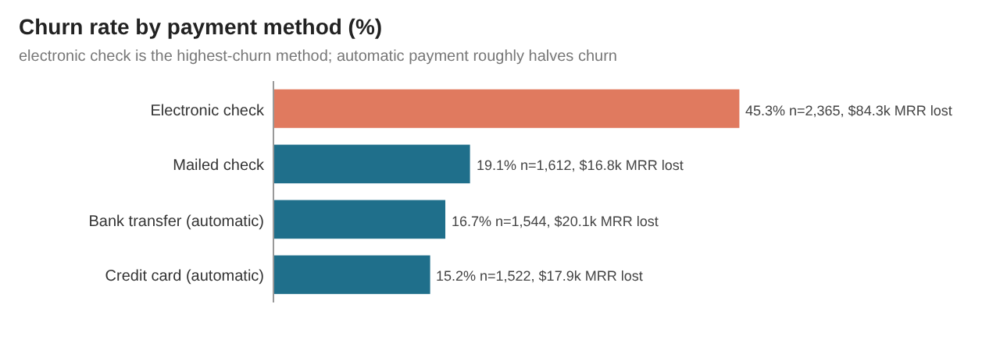

| is_paperless | customers | churned | churn_rate_pct | churner_share_pct | mrr_lost | mrr_lost_share_pct | avg_monthly_charges | avg_tenure_months |
|---|---|---|---|---|---|---|---|---|
| 0 | 2,872 | 469 | 16.33 | 25.09 | 29,620.85 | 21.29 | 51.99 | 32.2 |
| 1 | 4,171 | 1,400 | 33.57 | 74.91 | 109,510 | 78.71 | 73.55 | 32.5 |

| charge_band | customers | churned | churn_rate_pct | churner_share_pct | mrr_lost | mrr_lost_share_pct | avg_monthly_charges | avg_tenure_months |
|---|---|---|---|---|---|---|---|---|
| a <$30 | 1,653 | 162 | 9.8 | 8.67 | 3,583.75 | 2.58 | 21.5 | 29.0 |
| b $30-49 | 641 | 199 | 31.05 | 10.65 | 8,527.15 | 6.13 | 42.74 | 21.2 |
| c $50-69 | 1,158 | 234 | 20.21 | 12.52 | 14,038.95 | 10.09 | 59.86 | 29.7 |
| d $70-89 | 1,847 | 701 | 37.95 | 37.51 | 55,926.9 | 40.2 | 79.99 | 29.2 |
| e $90+ | 1,744 | 573 | 32.86 | 30.66 | 57,054.1 | 41.01 | 100.99 | 44.8 |

## Internet service and add-ons
| internet_service | customers | churned | churn_rate_pct | churner_share_pct | mrr_lost | mrr_lost_share_pct | avg_monthly_charges | avg_tenure_months |
|---|---|---|---|---|---|---|---|---|
| Fiber optic | 3,096 | 1,297 | 41.89 | 69.4 | 114,300.05 | 82.15 | 91.5 | 32.9 |
| DSL | 2,421 | 459 | 18.96 | 24.56 | 22,529.2 | 16.19 | 58.1 | 32.8 |
| None | 1,526 | 113 | 7.4 | 6.05 | 2,301.6 | 1.65 | 21.08 | 30.5 |

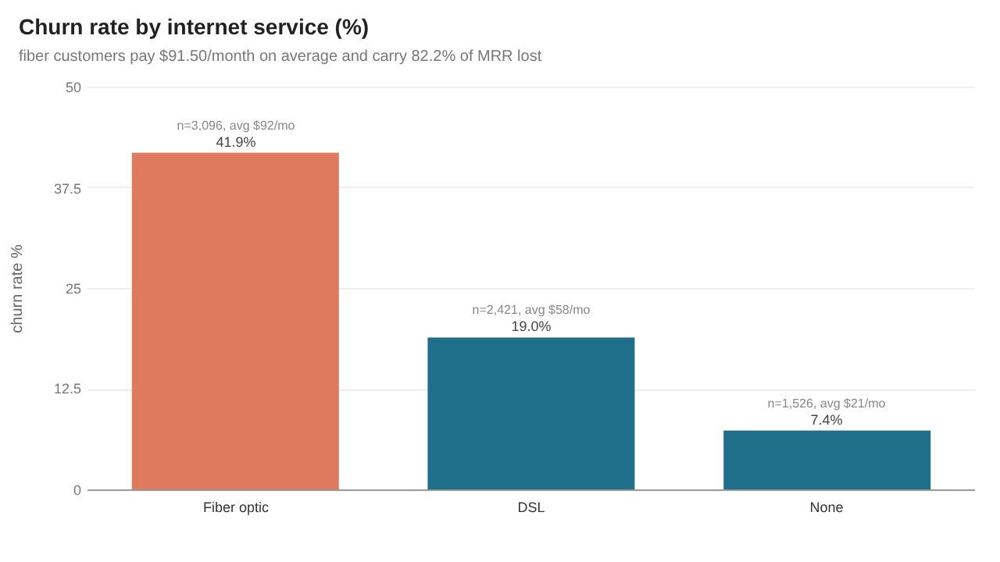

| contract | internet_service | customers | churned | churn_rate_pct | churner_share_pct | mrr_lost | mrr_lost_share_pct | avg_monthly_charges | avg_tenure_months |
|---|---|---|---|---|---|---|---|---|---|
| Month-to-month | Fiber optic | 2,128 | 1,162 | 54.61 | 62.17 | 100,482 | 72.22 | 87.02 | 21.6 |
| Month-to-month | DSL | 1,223 | 394 | 32.22 | 21.08 | 18,367.25 | 13.2 | 50.22 | 15.7 |
| One year | Fiber optic | 539 | 104 | 19.29 | 5.56 | 10,571.95 | 7.6 | 98.78 | 52.1 |
| One year | DSL | 570 | 53 | 9.3 | 2.84 | 3,356.25 | 2.41 | 61.4 | 40.5 |
| Two year | Fiber optic | 429 | 31 | 7.23 | 1.66 | 3,246.1 | 2.33 | 104.57 | 65.2 |
| Month-to-month | None | 524 | 99 | 18.89 | 5.3 | 1,997.85 | 1.44 | 20.41 | 9.1 |
| Two year | DSL | 628 | 12 | 1.91 | 0.64 | 805.7 | 0.58 | 70.46 | 59.1 |
| One year | None | 364 | 9 | 2.47 | 0.48 | 190.25 | 0.14 | 20.82 | 29.6 |
| Two year | None | 638 | 5 | 0.78 | 0.27 | 113.5 | 0.08 | 21.78 | 48.7 |

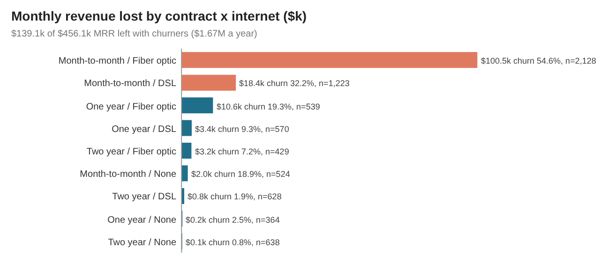

Add-ons, internet customers only (5,517; add-ons require internet):

| addon | customers_with | customers_without | adoption_pct | churn_rate_with_pct | churn_rate_without_pct | churn_diff_pp | mrr_lost_without |
|---|---|---|---|---|---|---|---|
| Online security | 2,019 | 3,498 | 36.6 | 14.61 | 41.77 | -27.16 | 112,762.75 |
| Tech support | 2,044 | 3,473 | 37.05 | 15.17 | 41.64 | -26.47 | 110,709.8 |
| Online backup | 2,429 | 3,088 | 44.03 | 21.53 | 39.93 | -18.4 | 91,873.85 |
| Device protection | 2,422 | 3,095 | 43.9 | 22.5 | 39.13 | -16.63 | 88,752.25 |
| Streaming movies | 2,732 | 2,785 | 49.52 | 29.94 | 33.68 | -3.74 | 63,263.55 |
| Streaming TV | 2,707 | 2,810 | 49.07 | 30.07 | 33.52 | -3.45 | 63,164.4 |

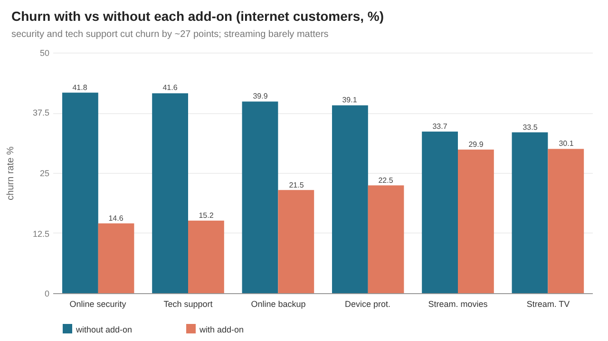

| addon_count | customers | churned | churn_rate_pct | churner_share_pct | mrr_lost | mrr_lost_share_pct | avg_monthly_charges | avg_tenure_months |
|---|---|---|---|---|---|---|---|---|
| 0 | 693 | 362 | 52.24 | 19.37 | 22,215.25 | 15.97 | 58.59 | 10.0 |
| 1 | 966 | 442 | 45.76 | 23.65 | 30,805.55 | 22.14 | 65.57 | 16.9 |
| 2 | 1,033 | 370 | 35.82 | 19.8 | 29,476.2 | 21.19 | 72.42 | 26.0 |
| 3 | 1,118 | 306 | 27.37 | 16.37 | 27,134.8 | 19.5 | 80.11 | 36.7 |
| 4 | 852 | 190 | 22.3 | 10.17 | 18,364.3 | 13.2 | 87.77 | 47.2 |
| 5 | 571 | 71 | 12.43 | 3.8 | 7,169.55 | 5.15 | 92.18 | 55.3 |
| 6 | 284 | 15 | 5.28 | 0.8 | 1,663.6 | 1.2 | 99.37 | 65.0 |

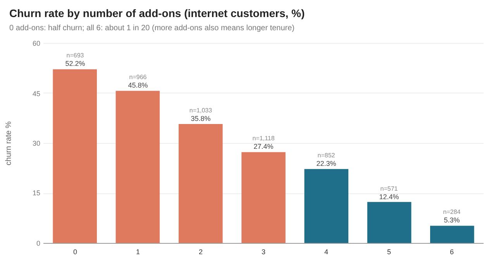

| service_profile | customers | churned | churn_rate_pct | churner_share_pct | mrr_lost | mrr_lost_share_pct | avg_monthly_charges | avg_tenure_months |
|---|---|---|---|---|---|---|---|---|
| Internet only | 682 | 170 | 24.93 | 9.1 | 6,380.75 | 4.59 | 42.03 | 31.7 |
| Phone + Internet | 4,835 | 1,586 | 32.8 | 84.86 | 130,448.5 | 93.76 | 81.76 | 33.0 |
| Phone only | 1,526 | 113 | 7.4 | 6.05 | 2,301.6 | 1.65 | 21.08 | 30.5 |

| service_group | service_name | subscribers | adoption_pct | churned | churn_rate_pct |
|---|---|---|---|---|---|
| Internet access | Internet: DSL | 2,421 | 34.37 | 459 | 18.96 |
| Internet access | Internet: Fiber optic | 3,096 | 43.96 | 1,297 | 41.89 |
| Phone | Multiple lines | 2,971 | 42.18 | 850 | 28.61 |
| Phone | Phone | 6,361 | 90.32 | 1,699 | 26.71 |
| Protection / support add-on | Device protection | 2,422 | 34.39 | 545 | 22.5 |
| Protection / support add-on | Online backup | 2,429 | 34.49 | 523 | 21.53 |
| Protection / support add-on | Online security | 2,019 | 28.67 | 295 | 14.61 |
| Protection / support add-on | Tech support | 2,044 | 29.02 | 310 | 15.17 |
| Streaming add-on | Streaming TV | 2,707 | 38.44 | 814 | 30.07 |
| Streaming add-on | Streaming movies | 2,732 | 38.79 | 818 | 29.94 |

## Demographics
| dimension | value | customers | churned | churn_rate_pct | avg_monthly_charges | avg_tenure_months | mrr_lost |
|---|---|---|---|---|---|---|---|
| Dependents | No | 4,933 | 1,543 | 31.28 | 67.0 | 29.8 | 115,376.5 |
| Dependents | Yes | 2,110 | 326 | 15.45 | 59.52 | 38.4 | 23,754.35 |
| Gender | Female | 3,488 | 939 | 26.92 | 65.2 | 32.2 | 70,248.55 |
| Gender | Male | 3,555 | 930 | 26.16 | 64.33 | 32.5 | 68,882.3 |
| Partner | No | 3,641 | 1,200 | 32.96 | 61.95 | 23.4 | 85,741.15 |
| Partner | Yes | 3,402 | 669 | 19.66 | 67.78 | 42.0 | 53,389.7 |
| Senior citizen | No | 5,901 | 1,393 | 23.61 | 61.85 | 32.2 | 100,711.25 |
| Senior citizen | Yes | 1,142 | 476 | 41.68 | 79.82 | 33.3 | 38,419.6 |

| household | customers | churned | churn_rate_pct | churner_share_pct | mrr_lost | mrr_lost_share_pct | avg_monthly_charges | avg_tenure_months |
|---|---|---|---|---|---|---|---|---|
| Single, no dependents | 3,280 | 1,123 | 34.24 | 60.09 | 80,705.65 | 58.01 | 62.98 | 23.3 |
| Partner, no dependents | 1,653 | 420 | 25.41 | 22.47 | 34,670.85 | 24.92 | 74.98 | 42.7 |
| Dependents, no partner | 361 | 77 | 21.33 | 4.12 | 5,035.5 | 3.62 | 52.51 | 23.9 |
| Partner + dependents | 1,749 | 249 | 14.24 | 13.32 | 18,718.85 | 13.45 | 60.97 | 41.4 |

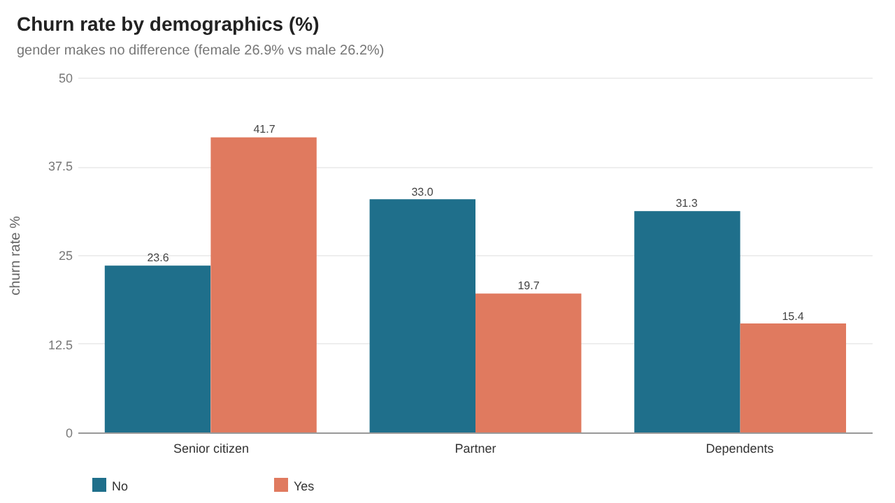

## Churn drivers (single factor) and risk segments
Churn rate when the attribute is true vs false, one factor at a time (factors overlap; this is a ranking aid, not a model):

| factor | customers_true | prevalence_pct | churn_rate_true_pct | churn_rate_false_pct | churn_diff_pp | churn_ratio |
|---|---|---|---|---|---|---|
| Month-to-month contract | 3,875 | 55.02 | 42.71 | 6.76 | 35.95 | 6.32 |
| Tenure <= 12 months | 2,186 | 31.04 | 47.44 | 17.13 | 30.31 | 2.77 |
| Electronic check | 2,365 | 33.58 | 45.29 | 17.06 | 28.23 | 2.65 |
| Fiber optic internet | 3,096 | 43.96 | 41.89 | 14.49 | 27.4 | 2.89 |
| Monthly charge >= $70 | 3,591 | 50.99 | 35.48 | 17.24 | 18.24 | 2.06 |
| Senior citizen | 1,142 | 16.21 | 41.68 | 23.61 | 18.08 | 1.77 |
| Paperless billing | 4,171 | 59.22 | 33.57 | 16.33 | 17.24 | 2.06 |
| Streaming TV | 2,707 | 38.44 | 30.07 | 24.33 | 5.74 | 1.24 |
| Male | 3,555 | 50.48 | 26.16 | 26.92 | -0.76 | 0.97 |
| Has partner | 3,402 | 48.3 | 19.66 | 32.96 | -13.29 | 0.6 |
| Has dependents | 2,110 | 29.96 | 15.45 | 31.28 | -15.83 | 0.49 |
| Tech support | 2,044 | 29.02 | 15.17 | 31.19 | -16.02 | 0.49 |
| Online security | 2,019 | 28.67 | 14.61 | 31.33 | -16.72 | 0.47 |
| Automatic payment | 3,066 | 43.53 | 15.98 | 34.67 | -18.69 | 0.46 |
| No internet service | 1,526 | 21.67 | 7.4 | 31.83 | -24.42 | 0.23 |
| Two-year contract | 1,695 | 24.07 | 2.83 | 34.05 | -31.22 | 0.08 |

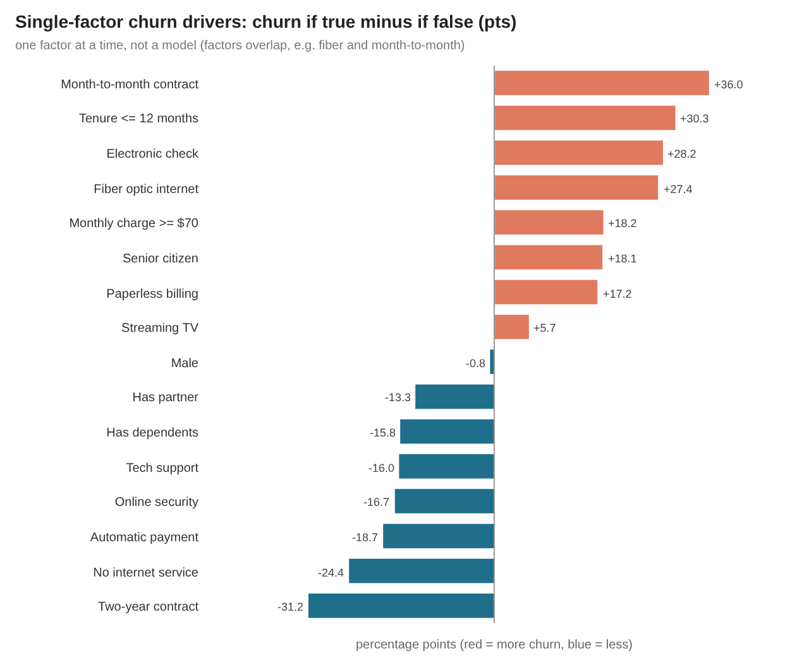

Contract × internet × payment segments with at least 100 customers, ranked by churn rate:

| risk_rank | contract | internet_service | payment_method | customers | churned | churn_rate_pct | mrr_lost | mrr_lost_share_pct | avg_tenure_months |
|---|---|---|---|---|---|---|---|---|---|
| 1 | Month-to-month | Fiber optic | Electronic check | 1,307 | 789 | 60.37 | 68,281.5 | 49.08 | 19.4 |
| 2 | Month-to-month | Fiber optic | Mailed check | 201 | 102 | 50.75 | 8,407.25 | 6.04 | 13.9 |
| 3 | Month-to-month | Fiber optic | Bank transfer (automatic) | 327 | 149 | 45.57 | 13,062.1 | 9.39 | 28.8 |
| 4 | Month-to-month | Fiber optic | Credit card (automatic) | 293 | 122 | 41.64 | 10,731.15 | 7.71 | 28.5 |
| 5 | Month-to-month | DSL | Electronic check | 474 | 192 | 40.51 | 8,776.45 | 6.31 | 14.9 |
| 6 | Month-to-month | DSL | Mailed check | 367 | 113 | 30.79 | 5,292.1 | 3.8 | 10.6 |
| 7 | Month-to-month | DSL | Credit card (automatic) | 185 | 50 | 27.03 | 2,474.8 | 1.78 | 21.0 |
| 8 | One year | Fiber optic | Electronic check | 196 | 51 | 26.02 | 5,149.65 | 3.7 | 51.8 |
| 9 | Month-to-month | None | Mailed check | 325 | 67 | 20.62 | 1,345.05 | 0.97 | 7.1 |
| 10 | Month-to-month | DSL | Bank transfer (automatic) | 197 | 39 | 19.8 | 1,823.9 | 1.31 | 22.4 |
| 11 | One year | Fiber optic | Credit card (automatic) | 150 | 23 | 15.33 | 2,392.35 | 1.72 | 54.7 |
| 12 | One year | Fiber optic | Bank transfer (automatic) | 157 | 23 | 14.65 | 2,344.35 | 1.68 | 51.8 |

The single segment month-to-month + fiber + electronic check holds 1,307 customers (18.6%), churns at 60.37% and accounts for 49.08% of all MRR lost ($68,281.50 a month).

## Data quality
Row counts (raw → clean → star):

| entity | raw_rows | distinct_keys | clean_rows | grain |
|---|---|---|---|---|
| customers | 7,043 | 7,043 | 7,043 | customer_id |
| dim_contract |  | 3 | 3 | contract type |
| dim_customer |  |  | 7,043 | customer_id |
| dim_demographics |  |  | 16 | gender x senior x partner x dependents |
| dim_payment |  | 4 | 4 | payment method |
| dim_service |  |  | 10 | service line |
| dim_services |  |  | 322 | distinct service bundle |
| dim_tenure_band |  |  | 7 | tenure band |
| fact_service |  |  | 29,202 | customer x subscribed service line |
| fact_subscription |  |  | 7,043 | customer (current subscription snapshot) |

Missing / special values:

| entity | column_name | raw_missing_pct | clean_null_pct | treatment |
|---|---|---|---|---|
| stg_telco | MultipleLines = 'No phone service' | 9.683 | 0.0 | not missing: -> has_multiple_lines 0 (label kept in multiple_lines_label) |
| stg_telco | TotalCharges (blank string) | 0.156 | 0.0 | all blanks have tenure 0 (never billed) -> 0.00, raw blank kept as dq_total_charges_blank |
| stg_telco | add-ons = 'No internet service' | 21.667 | 0.0 | not missing: a third category; -> flag 0 (has_internet = 0 carries the meaning) |
| stg_telco | any other column | 0.0 | 0.0 | no other missing values in the source |

Issues found and how they were handled:

| check_name | affected_rows |
|---|---|
| InternetService 'No' renamed 'None' | 1,526 |
| MonthlyCharges outside Q1/Q3 -/+ 1.5*IQR (flagged, kept) | 0 |
| MultipleLines 'No phone service' -> has_multiple_lines 0 | 682 |
| SeniorCitizen 0/1 standardised to is_senior + Yes/No label | 7,043 |
| TotalCharges below one MonthlyCharges with tenure >= 1 (flagged, kept) | 0 |
| TotalCharges blank string (all tenure = 0) -> 0.00 | 11 |
| TotalCharges off MonthlyCharges x tenure by > 25% (flagged, kept) | 27 |
| TotalCharges outside Q1/Q3 -/+ 1.5*IQR (flagged, kept) | 0 |
| customers with 'No internet service' in the 6 add-on columns -> flags 0 | 1,526 |
| duplicate customer_id dropped | 0 |
| exact duplicate rows in raw file | 0 |
| identical 19-attribute profile under different customer ids (synthetic data; kept) | 42 |

TotalCharges vs MonthlyCharges × tenure (ratio bands):

| ratio_band | customers | churned | churn_rate_pct | avg_tenure_months |
|---|---|---|---|---|
| a not billed yet (tenure 0) | 11 | 0 | 0.0 | 0.0 |
| b < 0.75 (flag) | 8 | 4 | 50.0 | 3.4 |
| c 0.75-0.95 | 689 | 192 | 27.87 | 17.1 |
| d 0.95-1.05 | 5,654 | 1,495 | 26.44 | 36.1 |
| e 1.05-1.25 | 662 | 173 | 26.13 | 17.8 |
| f > 1.25 (flag) | 19 | 5 | 26.32 | 3.4 |

Assertions (all must pass; the runner exits non-zero otherwise):

| check_name | failed_rows | status |
|---|---|---|
| >25% charge gaps (dq_charges_mismatch) only in the first year (tenure <= 12) | 0.0 | PASS |
| MRR reconciles raw -> fact (abs diff < 0.01) | 0.0 | PASS |
| SeniorCitizen is 0/1 and gender Female/Male | 0.0 | PASS |
| TotalCharges within 8 x MonthlyCharges of MonthlyCharges x tenure (price-drift tolerance) | 0.0 | PASS |
| addon_count = sum of the 6 add-on flags (0-6) | 0.0 | PASS |
| blank TotalCharges only where tenure = 0 | 0.0 | PASS |
| churned count reconciles raw Churn = Yes | 0.0 | PASS |
| clean rows = distinct raw customer ids (nothing lost) | 0.0 | PASS |
| contract / payment / internet values in the expected sets | 0.0 | PASS |
| customer_id format NNNN-XXXXX | 0.0 | PASS |
| customer_id unique in cln_customers | 0.0 | PASS |
| every Yes/No column mapped to 0/1 (no NULL flags) | 0.0 | PASS |
| every customer has phone or internet | 0.0 | PASS |
| every tenure-0 customer had a blank TotalCharges | 0.0 | PASS |
| fact_service rows = sum of subscribed flags | 0.0 | PASS |
| fact_service.customer_id -> dim_customer, service -> dim_service | 0.0 | PASS |
| fact_subscription keys -> dims (contract, payment, demographics, services, tenure band) | 0.0 | PASS |
| fact_subscription rows = cln_customers rows (every dim join matched) | 0.0 | PASS |
| lifetime revenue reconciles raw -> fact (abs diff < 0.01) | 0.0 | PASS |
| mrr_lost + mrr_retained = monthly_charges | 0.0 | PASS |
| no NULL total_charges after cleaning | 0.0 | PASS |
| no internet => all 6 add-on flags 0 and raw add-ons say 'No internet service' | 0.0 | PASS |
| no phone => MultipleLines 'No phone service' and has_multiple_lines 0 | 0.0 | PASS |
| segment totals reconcile (contract, tenure band, payment, internet) | 0.0 | PASS |
| tenure 0-72 months, MonthlyCharges 18-120 | 0.0 | PASS |
| tenure 1: TotalCharges = MonthlyCharges | 0.0 | PASS |
| tenure bands cover 0-72 without overlap | 0.0 | PASS |

## Files
- `metrics.json`: headline KPIs, data-quality summary, engine versions (DuckDB 1.5.6, Python 3.13.5) and SQL timings.
- `JSON.shot`: compact snapshot of the headline numbers and run config (valid JSON).
- `tables/*.csv`: every `a_*` analysis table and `dq_*` quality table.
- `images/*.svg` + `images/*.png`: 12 charts (dashboard + 11 individual). SVGs are drawn by `scripts/svgcharts.py` from plain vector shapes; PNGs are 2x headless-Chrome renders of the same SVGs (`scripts/render_png.py`).
- `sample/` (gitignored): written by `python run_pipeline.py --source sample` from the committed 1,477-customer sample, for a quick check without downloading.
